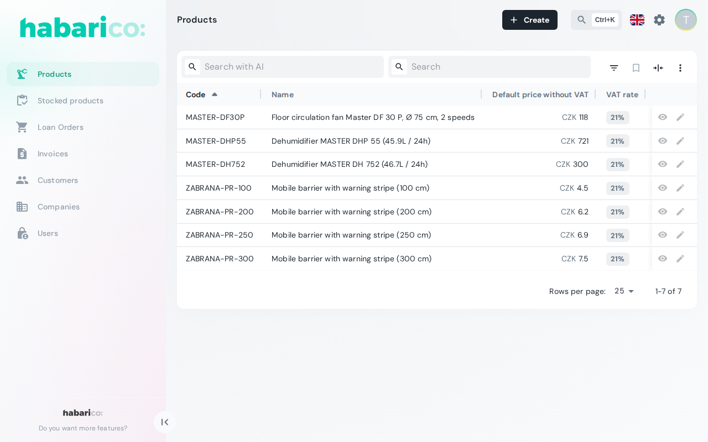

A Habarico application has two halves that only ever talk through schemas and REST calls.

1. A **backend** library (Python or Ruby) defines resources via admin classes or a DSL and exposes
   a schema endpoint next to the usual CRUD endpoints.
2. The **frontend** library fetches those schemas and renders the list, show, create, edit and
   action views from them — fields, inputs, filters, layout containers (boxes), menu entries and
   action buttons included.

## The schema endpoints

Schemas are served at five levels of detail, so the frontend only downloads what a screen needs:

<div class="table--even-columns">

| Endpoint | Returns |
| --- | --- |
| `/{api_prefix}/{service_name}/admin/schema/` | Every resource of the service with its views, actions and menu — enough to build the navigation |
| `/{api_prefix}/{service_name}/admin/{resource_name}/schema/` | The views and actions available on the resource collection, in full detail |
| `/{api_prefix}/{service_name}/admin/{resource_name}/{record_pk}/schema/` | The views and actions available on a single record, in full detail |
| `/{api_prefix}/{service_name}/admin/{resource_name}/{action_name}/schema/` | The form one collection action needs |
| `/{api_prefix}/{service_name}/admin/{resource_name}/{record_pk}/{action_name}/schema/` | The form one action needs on that record |

</div>

The service-level schema is the entry point: it is fetched once, drives the menu and tells the
frontend which resources exist. Detail schemas are fetched per screen, which is what makes
per-record permissions and record-dependent forms possible.

Every endpoint is described in the [API reference](/api).

## What a schema contains

A resource schema describes, in backend terms:

- **fields** — name, type, label, validation and formatting of every field the resource exposes
- **views** — which of list / show / create / edit exist, and how their contents are laid out
- **actions** — the operations offered beyond CRUD, with the form schema each one needs
- **menu** — where the resource appears in the navigation, with its label and icon
- **permissions** — whether the current user may read, create, update or delete

The frontend maps each field type to a component. When a type has no built-in component, or the
built-in one does not fit, you register your own — the schema stays unchanged.

## Request flow

```
Browser                          Frontend                      Backend
   |                                 |                             |
   |-- opens /admin --------------->|                             |
   |                                 |-- GET /admin/schema ------->|
   |                                 |<-- resources, menu ---------|
   |<-- navigation rendered ---------|                             |
   |                                 |                             |
   |-- opens a resource list ------->|                             |
   |                                 |-- GET /admin/{res}/schema ->|
   |                                 |-- GET /admin/{res} -------->|
   |                                 |<-- schema + records --------|
   |<-- list rendered ---------------|                             |
```

This is what the flow above produces — a list view nobody wrote: columns, filters, sorting,
pagination and row actions all come from the resource schema.



## snake_case on the wire, camelCase in the components

Both backends emit the schema in snake_case, exactly as the
[OpenAPI contract](/api) describes it — `text_align`, `dynamic_render`, `icons_key`. The frontend
converts every key to camelCase as it receives the schema, which is why the same option reads as
`options.textAlign` in the [TypeScript types](/node/types-and-schemas/) and as `text_align` in a
backend snippet. A handful of keys are exempt, because they carry user data rather than schema
keys, and keep their contents untouched: `defaultFilters`, `sortForFilters` and `extraFilters`
everywhere, plus `parameters`, `defaultValue` and `data` in a resource schema.

Because both backends emit the same schema shape, the same frontend build works against a Django
service and a Rails service alike — and a service can be migrated from one to the other without
touching the admin UI. What differs is the feature set, not the shape — see
[Python and Ruby parity](./backend-parity.md).

One subsystem is the exception: the AI integration exists only in the Python library, so an admin
using it is not backend-interchangeable. See [Python and Ruby parity](./backend-parity.md) for the
full split, including the paid features and where the two enum lists differ.
