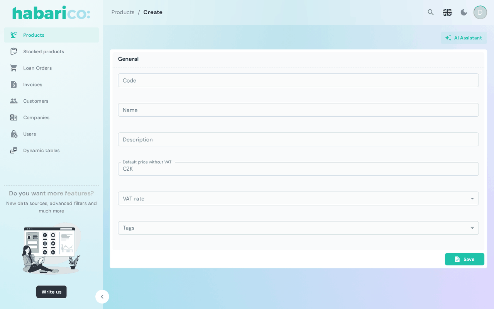

Renders the create form of a resource from its schema, and submits it to the create endpoint.

A resource gets this view automatically. Mount it explicitly to intercept the submit, add form
actions, or replace the generated form.

## Example

```tsx
<SchemaResource
  name="eshop/product"
  create={
    <SchemaCreate
      params={{source: 'catalog-import'}}
      onPostSubmit={() => notify('Product created')}
    />
  }
/>
```



## Props

On top of these it accepts React Admin's `CreateProps` except `children`.

| Name | Type | Default | Description |
|---|---|---|---|
| `name` | `string` | `'create'` | Which create view of the schema to render |
| `children` | `ReactNode` | generated form | Replaces the generated inputs |
| `onSubmit` | `SubmitHandler<FieldValues>` | default create call | Takes over submitting entirely |
| `onPostSubmit` | `() => void` | — | Runs after a successful save |
| `params` | `Record<string, string>` | — | Extra query parameters sent with the request |
| `title` | `ReactNode` | `<SchemaViewTitle />` | Card header |
| `toolbarActions` | `ReactNode` | `<SchemaViewToolbarActions />` | Buttons next to the title |
| `formActions` | `ReactNode` | `<SchemaFormActions />` | Buttons in the form toolbar; defaults to a save button |

The slots are described in detail on
[View slots](./view-slots-title-toolbar-actions-form-actions-list-actions.md).

:::caution
`onSubmit` replaces the save — the record is not created unless your handler does it. To only react
to a save, use `onPostSubmit`.
:::

## Where it goes afterwards

The redirect follows `afterSave` in the view schema: `list`, `show`, `prev` or `stay`. A
`triggerAction` returned with the created record that redirects in the same tab goes there instead
(see [action results](../types-and-schemas/view-schema-and-action-schema.md#action-results)). With
`navigationGuard` enabled on [SchemaAdmin](../base-components/schema-admin.md), leaving a dirty
form asks for confirmation first.

## See also

- [SchemaEdit](./schema-edit-component.md) — the same form for an existing record
- [Form schema generators](/python/view-generators/form-schema-generators) — declaring the form on the Python side
- [Create/edit view boxes](/ruby/schema-and-field-customization/create-edit-view-boxes) — the same on the Ruby side
