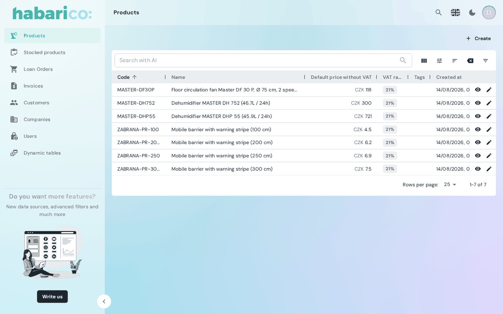

Renders the list view of a resource: columns, filters, sorting, pagination and row actions, all
from the view schema.

A resource gets this view automatically. Mount it explicitly only to pass one of the slots below
or to wrap the generated content in your own.

## Example

```tsx
<SchemaResource
  name="eshop/product"
  list={
    <SchemaList listActions={<><SchemaListActions /><ImportButton /></>}>
      <ProductListContent />
    </SchemaList>
  }
/>
```



## Props

| Name | Type | Default | Description |
|---|---|---|---|
| `name` | `string` | `'list'` | Which list view of the schema to render, when the resource has several |
| `children` | `ReactNode` | generated content | Replaces the generated datagrid |
| `title` | `ReactNode` | `<SchemaViewTitle />` | Card header; `null` removes it |
| `toolbarActions` | `ReactNode` | `<SchemaViewToolbarActions />` | Buttons next to the title; `null` removes them |
| `listActions` | `ReactNode` | `<SchemaListActions />` | Utility row — column selector, resets, filter toggle |
| `datagridButtons` | `ReactNode` | — | Extra buttons rendered in the datagrid's row action column |

The slots are described in detail on
[View slots](./view-slots-title-toolbar-actions-form-actions-list-actions.md).

## What the schema drives

| Schema | Effect |
|---|---|
| `ListViewParameters.boxes` | Which columns appear and in what order |
| `ListViewParameters.filters` | The offered filters; each one with `isAlwaysOn` goes into the always-visible toolbar row, the rest into the filter drawer |
| `ListViewParameters.extraFilters` | Filters applied on top of the user's, and not shown |
| `ListViewParameters.toolbarActions` | Buttons next to the title |
| `ListViewParameters.listActions` | Utility actions next to the filter bar |
| `ListViewParameters.rowActions` | Buttons in the row action column |
| `ListViewParameters.defaultSorting` / `sortable` | Initial sort, and drag-and-drop ordering |
| `singleClickAction` / `doubleClickAction` | What clicking a row does; falls back to `defaultRowAction` on [SchemaAdmin](../base-components/schema-admin.md) |

## See also

- [Datagrid components](../datagrid-components.md) — the table itself
- [List view schema generators](/python/view-generators/list-view-schema-generators) — declaring the list on the Python side
- [List view](/ruby/schema-and-field-customization/list-view) — the same on the Ruby side
- [useExporter](../hooks/use-exporter.md) — the backend export behind the export button
