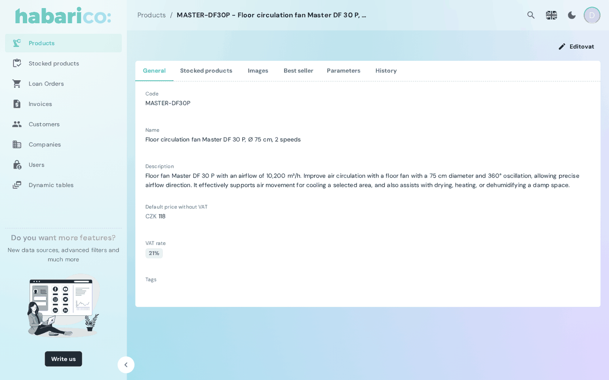

Renders the read-only detail view of one record, laid out by the boxes the schema declares.

A resource gets this view automatically. Mount it explicitly to pass a slot or to replace the
generated content.

## Example

```tsx
<SchemaResource
  name="eshop/order"
  show={
    <SchemaShow>
      <OrderShowContent />
    </SchemaShow>
  }
/>
```



## Props

| Name | Type | Default | Description |
|---|---|---|---|
| `name` | `string` | `'show'` | Which show view of the schema to render, when the resource has several |
| `children` | `ReactNode` | generated content | Replaces the generated layout |
| `title` | `ReactNode` | `<SchemaViewTitle />` | Card header; falls back to the record's `meta.repr` in a dialog |
| `toolbarActions` | `ReactNode` | `<SchemaViewToolbarActions />` | Buttons next to the title; `null` removes them |

The slots are described in detail on
[View slots](./view-slots-title-toolbar-actions-form-actions-list-actions.md).

## What the schema drives

`DetailViewParameters.box` is the layout — tabs, grids, related lists — and
`DetailViewParameters.toolbarActions` are the buttons. Because the show view requests the
per-record schema, actions and boxes can differ per record: an order that is already paid can be
served a schema without the “Mark as paid” action rather than a disabled button.

## See also

- [Show/detail view](/ruby/schema-and-field-customization/show-detail-view) — declaring the view on the Ruby side
- [SchemaEdit](./schema-edit-component.md) — the editable counterpart
- [Layout components](../layout-components/index.md) — the boxes doing the layout
